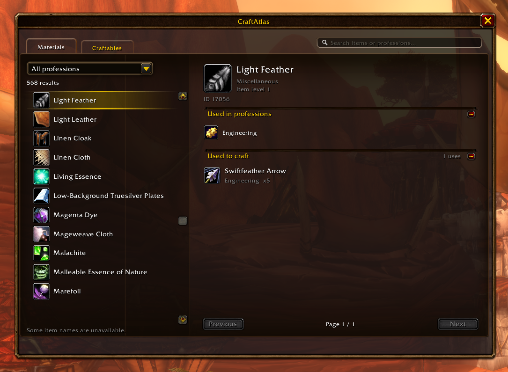
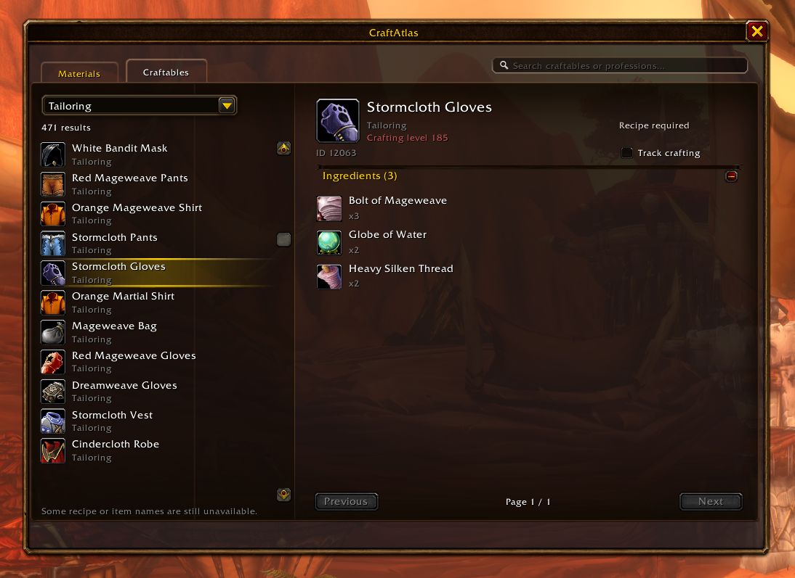
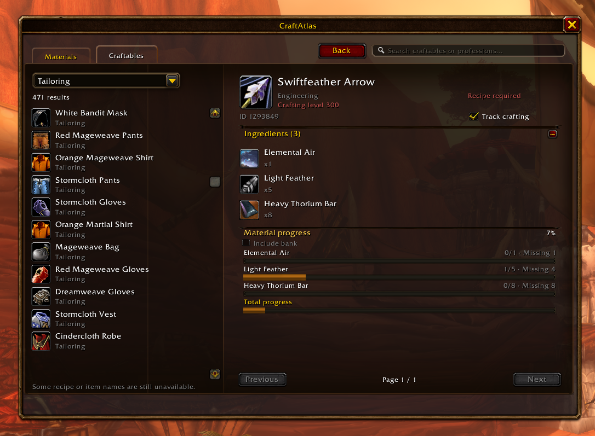
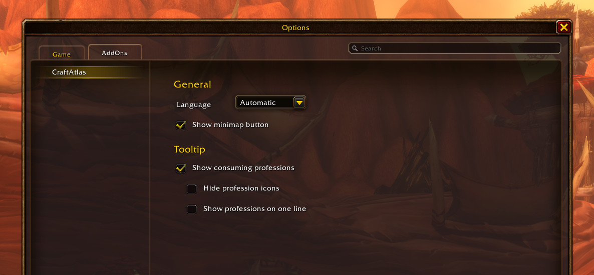
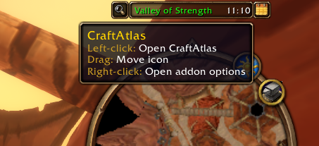
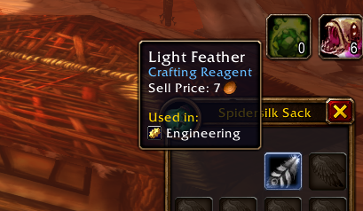

# CraftAtlas screenshots

These visual examples from the Forever client were contributed by `sebasgrios` and first shared in [PR #80](https://github.com/hectoresen/CraftAtlas/pull/80). See the [release history](https://github.com/hectoresen/CraftAtlas/releases) for published versions and the [testing guide](../TESTING.md) for Forever acceptance results.

## Materials

Browse materials by profession and see what each material is used to craft.

## Craftables

See the crafting requirements and ingredients for a selected craftable.

## Crafting tracking

Track how many ingredients you have for the selected craftable.

## AddOn options

Configure the addon from the game's AddOns options.

## Minimap button tooltip

Hover over the minimap button to see its mouse controls.

## Item tooltip

See which professions use the material directly in its item tooltip.
